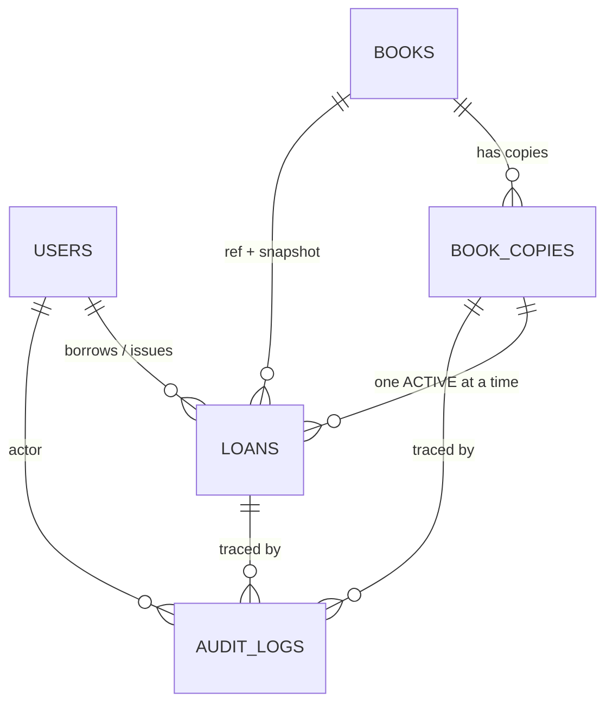

# University Library Management System

A backend for a university library: catalogue management, physical-copy inventory, book discovery and availability, circulation (issue / return / lost / corrections), historical preservation, and an append-only business audit trail — built as a **modular monolith** on **NestJS + MongoDB (Mongoose)**, with **Swagger**, **Docker**, and a **Jest** unit + integration suite.

The design treats data consistency across `loans`, `book_copies`, and `audit_logs` as the central concern: every multi-document operation runs in a **MongoDB transaction**, and concurrency on the "last available copy" is guarded by both an **atomic conditional update** and a **partial unique index**.

---

## Table of contents
- [University Library Management System](#university-library-management-system)
  - [Table of contents](#table-of-contents)
  - [Technology](#technology)
  - [Quick start (Docker)](#quick-start-docker)
  - [Local development](#local-development)
  - [Seeding \& demo accounts](#seeding--demo-accounts)
  - [API \& Swagger](#api--swagger)
    - [Student flows](#student-flows)
    - [Librarian flows](#librarian-flows)
    - [Shared / public](#shared--public)
  - [Architecture](#architecture)
  - [Domain model \& indexes](#domain-model--indexes)
  - [Key workflows](#key-workflows)
  - [Transactions \& concurrency strategy](#transactions--concurrency-strategy)
  - [Audit \& correction strategy](#audit--correction-strategy)
  - [Authentication \& authorization](#authentication--authorization)
  - [Testing](#testing)
  - [Business assumptions](#business-assumptions)
  - [Cloud deployment notes](#cloud-deployment-notes)
  - [Known limitations \& future extensions](#known-limitations--future-extensions)

---

## Technology
- **Runtime/Language:** Node.js 22, TypeScript (strict)
- **Framework:** NestJS 10 (modular monolith)
- **Database:** MongoDB 7 via Mongoose 8 (replica set required for transactions)
- **Auth:** JWT access tokens (stateless), Argon2id password hashing
- **Docs:** Swagger / OpenAPI at `/docs`
- **Security:** Helmet, CORS, rate-limited auth endpoints, centralized exception filter, credential redaction in logs
- **Testing:** Jest + `@nestjs/testing` + Supertest; integration tests run against a real replica set

---

## Quick start (Docker)

Transactions require a replica set; the bundled compose file starts a **single-node replica set** and initializes it automatically.

```bash
cp .env.example .env            # adjust JWT_SECRET for anything non-local
docker compose up --build       # starts MongoDB (replica set) + the API
```

Then, in another terminal, seed demo data:

```bash
docker compose exec api node dist/seed/seed.cli.js
```

- API: http://localhost:3000/api/v1
- Swagger UI: http://localhost:3000/docs
- Health: http://localhost:3000/api/v1/health

Stop with `docker compose down` (add `-v` to also drop the database volume).

---

## Local development

Two options for the database — both must support transactions:

**A. MongoDB Atlas (recommended for iterative dev).** Create a free cluster, then set `MONGODB_URI` in `.env` to the SRV string (Atlas clusters are replica sets, so transactions work out of the box).

**B. Local Docker replica set.** `docker compose up mongo` and point `MONGODB_URI` at `mongodb://localhost:27017/library?replicaSet=rs0`.

> **Why a replica set?** MongoDB's multi-document ACID transactions depend on the oplog-based commit protocol, which only exists on replica set members — a standalone `mongod` has no oplog and will reject any `startTransaction()` call. The compose file initialises a single-node `rs0` automatically, so it is equivalent to a full replica set for all transaction purposes.

```bash
npm install
cp .env.example .env            # set MONGODB_URI + JWT_SECRET
npm run start:dev               # watch mode
npm run seed                    # seed demo data (uses ts-node)
```

---

## Seeding & demo accounts

`npm run seed` (or `node dist/seed/seed.cli.js` in Docker) is **idempotent** — safe to run repeatedly. It creates a librarian, two students, and three books with copies.

| Role | Email | Password |
|---|---|---|
| Librarian | `librarian@university.edu` | `Librarian@123` |
| Student | `student@university.edu` | `Student@123` |
| Student | `student2@university.edu` | `Student@123` |

> **Development-only credentials.** Never reuse these in production. Override them via `SEED_*` environment variables.

---

## API & Swagger

All routes are under `/api/v1`. The interactive reference — DTOs, request/response shapes, roles, error codes, try-it-out — is at **`/docs`** (Swagger UI). Authenticate there with the `accessToken` from `POST /auth/login` (Authorize → Bearer).

The flows below describe how each role moves through the system end-to-end.

### Student flows

| Goal | Sequence |
|---|---|
| Register & log in | `POST /auth/register` → `POST /auth/login` → save `accessToken` |
| Discover books | `GET /books?q=algorithms` (full-text stems) · `?author=...` · `?category=...` · `?isbn=...` |
| Check if a book is available | `GET /books/:id/availability` — available/on-loan counts + earliest estimated return date |
| Borrow a book | `POST /loans/issue` with `bookId` — system auto-picks any available copy; pass `copyId` to pick a specific one |
| Track active loans | `GET /loans/me?status=ACTIVE` · `?overdue=true` |
| Return a book | `POST /loans/:id/return` |
| View loan history | `GET /loans/me` (all statuses) · `GET /loans/:id` for a single loan |

### Librarian flows

| Goal | Sequence |
|---|---|
| Manage catalogue | `POST /books` → `PATCH /books/:id` → `POST /books/:id/archive` |
| Manage physical copies | `POST /books/:bookId/copies` · `PATCH /copies/:id` (location/condition) · `POST /copies/:id/repair` (DAMAGED→AVAILABLE) · `POST /copies/:id/retire` |
| Issue a book to a student | `GET /users/students/lookup?enrollmentNumber=...` (or `?email=...`) to resolve the student's id from their ID card → `POST /loans/issue` with `borrowerId` + `bookId` |
| Return with condition assessment | `POST /loans/:id/return` with `condition=GOOD\|DAMAGED` (student self-returns are always recorded as GOOD) |
| Handle a lost book | `POST /loans/:id/mark-lost` |
| Post-return damage (student self-return) | `POST /loans/:id/damage-claim` — allowed within 48 h if the copy hasn't been re-issued |
| Correct a loan / void accidental issue | `POST /loans/:id/correct` (requires `correctionType` + `reason`) · `POST /loans/:id/void` |
| Suspend / reactivate a student | `PATCH /users/students/:id/suspend` · `POST /users/librarians` to onboard a new librarian |
| Audit trail | `GET /audit-logs` (search by entity/actor/action/date) · `GET /audit-logs/loan/:id` · `/copy/:id` · `/book/:id` |
| All loans | `GET /loans` (filterable by status, borrower, overdue) |

### Shared / public

| Endpoints | Who |
|---|---|
| `GET /books` · `/books/:id` · `/books/:id/availability` · `/books/:bookId/copies` · `/copies/:id` | any authenticated user |
| `GET /loans/me` · `GET /loans/:id` | student (own loans only) or librarian |
| `GET /auth/me` | any authenticated user |
| `POST /auth/register` · `POST /auth/login` · `GET /health` | public (no token required) |

Status codes across all endpoints: `400` invalid input · `401` unauthenticated · `403` wrong role / not owner · `404` missing · `409` conflict (copy unavailable, duplicate return, unique clash).

---

## Architecture

Modular monolith; business rules live in services, never controllers. Audit writing is a reusable service that **participates in the caller's transaction**.

```
src/
  config/         env loading + Joi validation
  database/       Mongoose connection + withTransaction() helper
  common/         guards, decorators, exception filter, correlation-id, redaction, PasswordService
  auth/           login / me, JWT strategy (stateless)
  users/          shared student+librarian collection; librarian creation; student lookup; suspension
  books/          catalogue CRUD, archival, search, availability (reads copies+loans)
  book-copies/    physical inventory lifecycle
  loans/          OWNER of circulation: issue/return/lost/correct/void/damage-claim
  audit-logs/     append-only business audit; read/search; AuditService.record(session, entry)
  health/         Mongo ping
  seed/           idempotent dev seeding (standalone CLI context)
```

Module dependencies are acyclic: the `loans` module reads the `Book`/`BookCopy`/`User` models directly (registered read-only via `MongooseModule.forFeature`) rather than depending on their services, so there are no circular service dependencies. Every domain module depends only on `AuditLogsModule` plus the models it needs.

---

## Domain model & indexes

Five collections. No `auth_sessions` (stateless auth), no `reservations` (out of scope), no availability/transactions collections (availability is **derived**).



- **users** — `name`, `email` (**unique**, normalized), `passwordHash`, `role` (`STUDENT|LIBRARIAN`), `status` (`ACTIVE|SUSPENDED`), optional `studentProfile{enrollmentNumber (unique, partial), department}`, optional `librarianProfile{employeeNumber (unique, partial)}`.
- **books** — `title`, `authors[]`, `isbn?` (**unique when present**, partial), `publisher?`, `edition?`, `publicationYear?`, `category?`, `status` (`ACTIVE|ARCHIVED`), `createdBy`. Text index on title/authors/category.
- **book_copies** — `bookId`, `barcode` (**unique**), `status` (`AVAILABLE|ON_LOAN|DAMAGED|LOST|RETIRED`), `location?`, `condition?`, `acquiredAt?`.
- **loans** — `bookId`, `copyId`, `borrowerId`, `issuedById`, `issuedAt`, `dueAt`, `status` (`ACTIVE|RETURNED|LOST|VOIDED`), `returnedAt?`, `returnedById?`, `returnReportedBy?`, `returnCondition?`, `conditionNotes?`, `bookSnapshot{...}`, `damageClaim?{...}`. **Partial unique index `{copyId}` where `status=ACTIVE`** enforces one active loan per copy. **Overdue is derived, never stored.**
- **audit_logs** — `actorId`, `actorType`, `action`, `entityType`, `entityId`, `changes[]{entityType, entityId, before, after}`, `reason?`, `correlationId`, `createdAt`. Append-only; indexed by entity, action, actor, and correlated change entities.

---

## Key workflows

- **Issue** — validate borrower (student, active, not suspended), book (`ACTIVE`), and copy↔book. If `copyId` is omitted, the system auto-selects any `AVAILABLE` copy of the given book. Then in one transaction: atomic `AVAILABLE → ON_LOAN` conditional update → create the loan (`dueAt = issuedAt + 14 days`, with a book snapshot) → write audit → commit.
- **Return** — loan must be `ACTIVE` (blocks duplicate returns). In one transaction: loan → `RETURNED`; copy → `AVAILABLE` / `DAMAGED` (librarian-assessed) / `RETIRED` (if the book is archived); audit → commit. Student self-returns are always recorded `GOOD` (students can't assess damage).
- **Mark lost** — active loan → `LOST`, copy → `LOST`, audited. Overdue never auto-escalates to lost.
- **Correct** — explicit, validated operation (no generic `PATCH`): requires a correction type + non-empty reason; rejects date corrections that would overlap another loan of the same copy. Before/after preserved in audit.
- **Void** — only an accidental **active** loan; frees (or retires) the copy; returned loans must use corrections instead.
- **Damage claim** — because a student self-return has no inspection, a librarian can claim damage within a configurable window (`DAMAGE_CLAIM_WINDOW_HOURS`, default 48h) — but only if the copy hasn't been re-issued since.
- **Archive** — blocks new issues; existing loans remain returnable; those copies are **retired** on return so they never re-enter circulation.

---

## Transactions & concurrency strategy

- A single `withTransaction(connection, work)` helper (`src/database/transaction.util.ts`) threads **one session** through every write — including the audit insert — and retries on `TransientTransactionError` / `UnknownTransactionCommitResult`.
- **Last-copy race — optimistic locking:** the issue path uses **optimistic concurrency control**, not pessimistic locking. No lock is acquired when the copy is first read; instead, the status assertion is pushed into the write itself:
  ```
  filter : { _id: copy._id, status: 'AVAILABLE' }   ← assertion: "it's still available"
  update : { $set: { status: 'ON_LOAN' } }           ← flip atomically only if filter matched
  ```
  Pessimistic locking (holding an exclusive lock from read through commit) is not an option in MongoDB — there is no `SELECT FOR UPDATE` equivalent. Optimistic locking fits naturally: contention on the last copy is rare, so optimistic is cheaper (no lock overhead on the common path), and the failure cost is simply a 409 the client can surface immediately. If two requests race, MongoDB serialises the two `updateOne` calls. The first finds `status: 'AVAILABLE'`, flips it, `modifiedCount === 1` → proceeds. The second finds the copy already `ON_LOAN`, filter matches nothing, `modifiedCount === 0` → 409. The **partial unique index** on `{copyId}` for `ACTIVE` loans is the second line of defence — even a retry or a bug cannot insert a second active loan for the same copy. Both layers are exercised by `test/concurrency.e2e-spec.ts`.
- Because the audit insert shares the business transaction, a business operation can never commit without its audit record, and a failure mid-operation rolls back the loan, the copy, and the audit together.

---

## Audit & correction strategy

- **What is audited:** every successful state-changing operation (issue, return, lost, correct, void, damage-claim, book create/update/archive, copy add/update/repair/retire, librarian create, user suspend/reactivate). Reads, failed attempts, and "copy unavailable" conflicts are **not** business-audited.
- **Correlation:** one audit document per business operation, with every touched entity in `changes[]` and a per-request `correlationId` — so a loan issue and its copy transition are traced together without duplicate records.
- **Immutability:** there are no audit update/delete endpoints; the service exposes insert + read only.
- **Safety:** credentials, hashes, and tokens are never written to audit records.
- **Corrections** update the loan to its corrected current state while the audit record preserves the previous and new values — the original loan is not silently deleted and the audit is not overwritten.

---

## Authentication & authorization

- **Stateless JWT access tokens** (no refresh/session store). The trade-off: logout is client-side and tokens cannot be revoked server-side before expiry — acceptable for this scope with short-lived tokens (`JWT_EXPIRES_IN`). Refresh-token rotation is a documented future extension.
- Passwords hashed with **Argon2id**.
- Global `JwtAuthGuard` (routes opt out via `@Public()`), `RolesGuard` (`@Roles(...)`), and ownership checks in the loans service.
- The **actor is always taken from the authenticated request**, never from the request body. Roles are never accepted from public registration. Only `STUDENT` and `LIBRARIAN` exist — no admin role.

---

## Testing

```bash
npm test            # unit tests (no DB)
npm run test:e2e    # integration tests (boots the full app against a replica set)
```

- **Integration tests** spin up an in-memory MongoDB **replica set** (`mongodb-memory-server`) so transactions behave exactly as in production, with **no Docker required** for the suite. To run them against the bundled Docker replica set instead, start `docker compose up mongo` and set `MONGODB_URI` before `npm run test:e2e`.
- Coverage of the high-risk areas: auth/ownership, duplicate ISBN/barcode, archive behavior, the full loan lifecycle, the 14-day due date, overdue derivation, corrections/void/damage-claim, audit completeness & immutability, and the **concurrent last-copy** race (exactly one success).

---

## Business assumptions

These were under-specified in the brief and resolved explicitly:

1. **Students self-issue and self-return; librarians have authority.** The brief says students "borrow books," so issuing a copy to oneself is a first-class student action (and makes the "multiple students race for the last copy" scenario direct). Librarians can issue/return on a student's behalf and own all condition assessment, lost declarations, and corrections.
2. **No fines, borrow limits, renewals, or grace periods** — the brief fixes no numbers. Only the 14-day period and the damage-claim window are policy values (both configurable). These are future configurable policies, not invented requirements.
3. **14-day period** is computed and stored at issue time in UTC: `dueAt = issuedAt + 14 * 24 * 60 * 60 * 1000`.
4. **Overdue is derived** (`status === ACTIVE && dueAt < now`), never stored, and never auto-escalates to lost.
5. **"When available again"** is the earliest `dueAt` among active loans — surfaced as an **estimate, not a guarantee** (a due date is not a promised return date).
6. **No hard deletes.** Books are archived, copies retired, users suspended, loans voided — history is always preserved.

---

## Cloud deployment notes

The app is 12-factor (all config via env, stateless auth, health endpoint). A reasonable AWS target, without over-engineering this submission:

- **Compute:** the container on **ECS Fargate** behind an ALB (HTTPS terminated at the load balancer).
- **Database:** **MongoDB Atlas** (managed replica set — transactions supported) or self-managed with equivalent HA.
- **Secrets:** `JWT_SECRET` and the DB URI in **AWS Secrets Manager**, injected as env vars.
- **Observability:** container logs + the correlation id on every request/response to **CloudWatch**; the `/health` endpoint as the ALB/ECS health check.
- **Backups/monitoring:** Atlas managed backups and alerts.

Infrastructure-as-code is intentionally out of scope.

---

## Known limitations & future extensions

- **Reservations / waiting lists** — not implemented; the data model leaves room for a `reservations` collection.
- **Notifications** (overdue reminders) — would be a scheduled job; overdue correctness does **not** depend on jobs today.
- **Refresh tokens / server-side revocation** — the current design is intentionally stateless.
- **Fines & payments, renewals, borrow limits** — deliberately omitted; belong in a configurable policy layer.
- **Self-return damage gap** — a copy is freed optimistically on student self-return; the librarian damage-claim window mitigates this but is void once the copy is re-issued (documented, not silent).
- **Frontend** — out of scope; Swagger + seed accounts demonstrate the backend.
